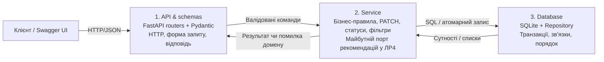
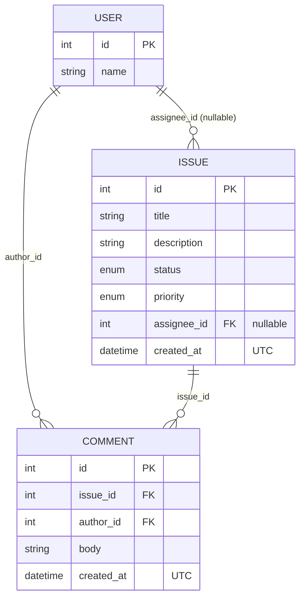

# Smart HelpDesk — архітектура та ADR

**Версія:** 1.0 • **ЛР1:** проєктування, без реалізації. Правила предметної області див. [`requirements.md`](requirements.md), §§5.1–5.7.

## 1. Мінімальна схема компонентів (3 компоненти)



**Межі відповідальності:**

1. **API & schemas:** опис `GET/POST/PATCH`, перевірка структури, типів, переліків та довжин; HTTP-коди; нормалізовані JSON-помилки, документація `/docs`.
2. **Service:** єдині правила з `requirements.md` — переходи станів, умови редагування CLOSED, атомарна обробка PATCH, поєднання фільтрів AND, виклик сховища. У ЛР4 — тільки опціональний інтерфейс до рекомендаційної логіки без автоматичного редагування.
3. **Database:** SQLite, транзакції, таблиці `users`, `issues`, `comments`, FK і перевірка зв'язків, `ORDER BY id ASC`.

Майбутній класифікатор — порт/адаптер усередині межі `Service` (не четвертий обов'язковий компонент ЛР1); мережеві LLM-виклики й окремий endpoint у поточному контракті **відсутні**.

## 2. Модель сутностей (3 сутності)



У таблиці `users` рівно два тестові записи: `(1, "Agent A")`, `(2, "Agent B")`. Для заявок і коментарів зберігаються серверні UTC-часи; числовий PK задає стабільний порядок. Всі обмеження форматів/довжин — **лише** у [`requirements.md`](requirements.md), §5; вони не дублюються альтернативними визначеннями тут.

### Орієнтовна структура ЛР2

```text
smart_helpdesk/
  app/
    main.py            # точка входу, маршрути і /health
    schemas.py         # Pydantic моделі та перевірка форми
    service.py         # бізнес-правила
    database.py        # підключення та транзакції
    models.py          # структури таблиць
    repository.py      # запити SQLite
  tests/
    test_issues.py
    test_status.py
    test_comments.py
  docs/                # артефакти ЛР1, спільні для ЛР2–ЛР4
```

Це **план**, а не заявлена реалізація. Застосунок у ЛР1 не програмується.

## 3. ADR-01 — локальний FastAPI + SQLite замість складнішого розгортання

**Статус:** прийнято для навчального проєкту.  
**Контекст:** невелика кількість синтетичних звернень, локальний показ REST API, потрібно зберігати записи між перезапусками.  
**Варіанти:** (A) FastAPI + SQLite; (B) PostgreSQL + сервер БД; (C) хмарна БД.  
**Обране рішення:** (A) Python/FastAPI + SQLite; локальний процес, одна БД.  
**Причина:** мінімальна конфігурація; підтримка транзакцій і зовнішніх ключів; можливість ізольованого pytest; стек рекомендований методичкою.  
**Наслідок/обмеження:** не закладаємо високе конкурентне навантаження, масштабування або публічну автентифікацію. Перехід до сервера БД можливий пізніше через репозиторій без зміни API-контракту.

## 4. ADR-02 — ізольований AI-модуль і людина контролює зміни

**Статус:** рішення для інтеграції у ЛР4, без поточної реалізації.  
**Контекст:** AI може помилково класифікувати звернення, бути недоступним чи видати нерелевантний результат. Основний облік звернень не повинен залежати від LLM.  
**Варіанти:** (A) LLM сам змінює `priority` і статус; (B) LLM пропонує категорію, пріоритет і підсумок, а основний сервіс їх лише відображає; (C) повністю відмовитися від AI.  
**Обране рішення:** (B) рекомендаційний адаптер/порт у `Service`; дані заявки не змінюються після AI-відповіді без явної дії користувача через наявний PATCH.  
**Причина:** контрольованість, можливість порівнювати рекомендацію з вхідним текстом, відсутність критичного впливу LLM на дані.  
**Наслідок/обмеження:** знадобиться валідація рекомендацій у ЛР4; при недоступності моделі FR-01–FR-07 продовжують працювати; ніяких API-ключів у Git.

## 5. Архітектурні інваріанти для перевірки

- Для `PATCH` вся команда перевіряється до запису й фіксується однією транзакцією (FR-03, FR-07).
- Перевірка переходу статусу відбувається в `Service` за **однією матрицею** (§5.4 вимог), а не повторюється у маршрутах.
- У SQLite ввімкнені foreign keys; коментар не існує без заявки або відомого автора.
- Технічні повідомлення сховища не витікають назовні як API-помилки.
- При будь-якій недоступності AI основний сервіс незалежний від мережі (NFR-05).
